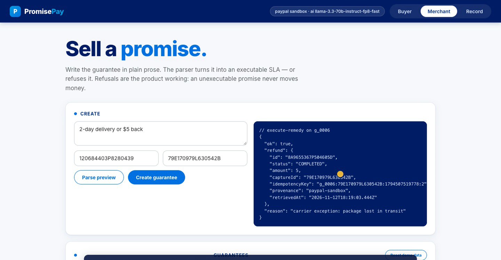
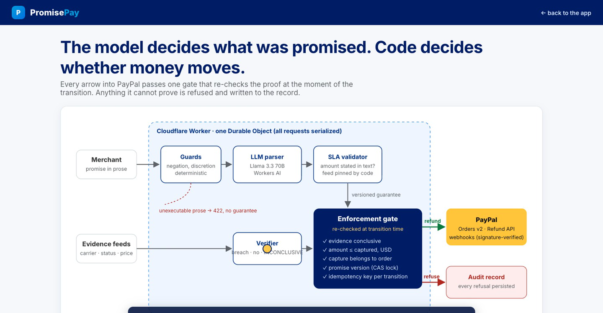
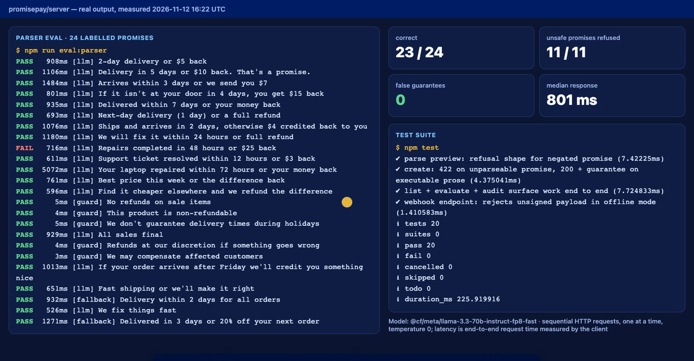

# PromisePay

**PromisePay helps small online merchants keep promises like "2-day delivery or $5 back" by turning the promise into a contract that checks the evidence and refunds through PayPal automatically, without a complaint or a dispute.**

[Live demo](https://promisepay.kiritokris.workers.dev) · [Watch the demo (2:37)](https://www.youtube.com/watch?v=Q96iujRDvLw) · [Architecture](https://promisepay.kiritokris.workers.dev/architecture.html) · [Devpost entry](https://devpost.com/software/simpli)



> Built for the **PayPal AI Hackathon 2026** ("Build what's next with PayPal and AI"). Prize focus: Best Use of PayPal + AI.

## The problem

Maya runs a small candle shop online. Her promise, "2-day delivery or $5 back", wins buyers' trust, but nothing enforces it. When a parcel is late, the buyer has to notice and complain, Maya checks tracking and refunds by hand, and the cases she misses become disputes.

Today a store guarantee is marketing copy. Refund tooling exists (PayPal's Refund API, dispute flows), but nothing connects **what the merchant promised** to **what actually happened** and **the money**, automatically and safely.

## Our solution

The merchant writes the promise in plain English. PromisePay:

1. **Reads it.** Llama 3.3 70B on Cloudflare Workers AI turns the prose into a strict contract (window, evidence source, remedy), or refuses prose it can't execute ("we'll credit you something nice").
2. **Watches the evidence.** Carrier and status events attach to the guarantee.
3. **Decides with code, not the model.** A rule-based verifier returns breach, no breach, or INCONCLUSIVE. Inconclusive never pays.
4. **Pays through PayPal.** One server-side gate re-checks every condition at the moment of the transition, then calls the PayPal Refund API with an idempotency key. Anything it can't prove is refused and written to the record.

### What makes it different

The model decides **what was promised**; code decides **whether money moves**. Most AI-payment projects let a model trigger a payment. PromisePay treats model output as untrusted: deterministic guards run before the model, every output is checked against the source text (a dollar amount must actually be written there), and the payout gate does not consult the model at all.

## See it in action

**Live:** https://promisepay.kiritokris.workers.dev (no login, no PayPal account, no keys; the page ships with a demo API key)

1. **Buyer** tab: Maya's enforced promise and its refund receipt.
2. **Merchant** tab: type a promise → **Parse preview** (shows the model and the contract, or the refusal) → **Create guarantee** → **＋ exception** (carrier event) → **Evaluate** (verdict `breach`) → **Execute remedy**.
3. Click **Execute remedy** again: refused (`transition_not_permitted`).
4. **Record** tab: every refusal persisted with the failed check.

**Expected outcome:** a refund record with `status: COMPLETED`, an idempotency key and a provenance label. Demo ids starting with `OFFLINE-` are labelled `fixture` (simulated, no money moves); a guarantee linked to a real sandbox order and capture refunds real sandbox money and is labelled `paypal-sandbox`. **Reset demo data** restores the curated dataset.

## Key features

**1. Prose → executable contract, or a refusal**
- What: any promise text becomes `{kind, verification, remedy}` JSON, or a refusal with a reason.
- Why: merchants write promises in words, not forms; unexecutable promises must never become guarantees.
- Evidence: `server/src/ai/parser.js`; 24-case live evaluation below (11/11 unsafe promises refused).

**2. Fail-closed enforcement gate**
- What: money moves only via `POST /api/guarantees/:id/execute-remedy`, which re-checks evidence, amount ≤ captured, currency, the capture's order (from PayPal), and the promise version.
- Why: a wrong refund is worse than no refund.
- Evidence: `server/src/enforce.js`; the 8-attack test matrix below.

**3. Real PayPal money movement with provenance**
- What: Orders v2, capture lookup, Refund API with `PayPal-Request-Id`, signature-verified webhooks. Every record says where its data came from (`paypal-sandbox` + retrieval time, or `fixture`).
- Why: judges and merchants can tell real money from simulation at a glance.
- Evidence: `server/src/paypal.js`; the sandbox proof below.

**4. Concurrency-safe, one refund per breach**
- What: compare-and-swap on the promise version plus an `executing` lock, inside one Cloudflare Durable Object.
- Why: double-clicks, retries and racing requests must never double-pay.
- Evidence: tests T5, T6 and the in-flight regression test.

**5. Enforcement record**
- What: every refusal is persisted with the failed check and what was observed.
- Why: the merchant can prove which promises were honoured and why others weren't paid.
- Evidence: **Record** tab; `store.audit` calls in `enforce.js`.

## How it works



1. **Input and validation:** deterministic guards (negation, discretionary remedies) → LLM parser → validator (stated amounts, full-refund wording, evidence feed pinned by SLA kind). Unexecutable prose returns 422 and no guarantee.
2. **Core processing:** evidence events → rule-based verifier → enforcement gate (re-checks at transition time).
3. **Storage and integrations:** state and audit trail in a single Durable Object; PayPal Orders v2, Payments (captures, refunds) and webhook verification.
4. **Output:** refund record with provenance, or a persisted refusal; buyer receipt and merchant console.

### Technology stack

| Layer | Technology | Why |
|---|---|---|
| Frontend | Zero-build HTML/JS served as Workers Static Assets | One URL for UI and API; nothing to install for judges |
| Backend | One route table, two runtimes: Cloudflare Worker + Durable Object (live), Express (local/tests) | Same code path in tests and production |
| AI | Llama 3.3 70B (`@cf/meta/llama-3.3-70b-instruct-fp8-fast`) on Cloudflare Workers AI; optional OpenAI-compatible endpoint | No external key needed in the deployment; temperature 0 |
| Payments | PayPal Orders v2, Payments Refund API, Webhooks (sandbox) | The money movement is PayPal's, end to end |
| Storage | Durable Object storage (live), JSON file (local) | Serialized writes make the compare-and-swap real |

### Technical decisions

- **Rule-based verifier, not an AI one.** The breach decision moves money, so it is deterministic and testable. AI is used where a form can't work: reading free-text promises.
- **Model failures fall back to a strict parser, never to a guess.** If the model's output fails validation, a deterministic parser decides; it refuses anything without an explicit window and amount.
- **Single Durable Object.** Every request serializes through one instance, which makes the version check and the `executing` lock genuinely atomic. Trade-off: throughput is bounded by one object, fine for a merchant-scale proof of concept.

## Innovation and hackathon alignment

- **Rule: "meaningfully use both PayPal and AI".** PayPal is the execution layer (capture lookup, Refund API, webhooks); AI is the only way the product reads its input. Remove either and the product does not exist.
- **Novel contribution:** connecting a merchant's own words to evidence and to an automatic, auditable refund. Our field scan of ~1,200 public hackathon repos found agent firewalls, dispute copilots and escrow tools, but no other self-executing service guarantees.
- **Judging criteria → evidence:**

| Criterion | Where to look |
|---|---|
| Technological implementation | Enforcement gate, attack matrix, real sandbox refund |
| Design | Live demo, buyer receipt + merchant console + record |
| Potential impact | The problem above: fewer disputes, no manual refunds, provable guarantees |
| Innovation | "What makes it different" |
| Presentation | Demo video (2:37) |

## Results and validation

| Metric | Result | Evidence |
|---|---|---|
| Parser accuracy, 24 labelled promises (13 executable, 11 unsafe) | **23/24** correct | `server/eval/results.json`, `npm --workspace server run eval:parser -- <url>` |
| Unsafe promises turned into guarantees | **0** (11/11 refused) | same |
| The one miss | Model omitted a 48 h window → refused; a refusal, not a wrong payout | same |
| Median response | **801 ms** overall, 908 ms when the model answered (p90 1.5 s) | sequential requests, temperature 0, 12 Nov 2026 |
| Automated tests | **20/20** pass | `npm test` |
| Real PayPal sandbox refund | **COMPLETED**, provenance `paypal-sandbox` | below |



**Real PayPal sandbox proof (12 Nov 2026, live site):** a $25.00 sandbox order (`120684403P8280439`, capture `79E170979L630542B`) was paid with PayPal's published sandbox test card through the app's own sandbox keys. PromisePay refunded $5 through the Refund API on the live deployment, both times with provenance `paypal-sandbox`: refunds `44D32886PK488123N`, `8A9655367P504605D` and `83H427093D801213B` (shown in the video). PayPal's refund webhook arrived and passed signature verification (`webhook_accepted` in the record).

**The adversarial matrix** (`server/test/adversarial.test.js`):

| # | Attack | Behaviour |
|---|---|---|
| T1 | No breach evidence at all | refused · `verdict_is_conclusive` persisted |
| T2 | Promise exceeds captured amount | refused · `remedy_within_captured_amount` |
| T3 | Corrupted capture reference | never ends in a completed refund |
| T4 | Unknown carrier status | INCONCLUSIVE ⇒ fail-closed |
| T5 | Stale promise version (concurrent edit) | refused · `stale_version` |
| T6 | Two racing executes | exactly one refund |
| T7 | Genuine evidenced breach | refund executes · `refunded` |
| T8 | PayPal declines the refund | `refund_failed` with the error on record |

## Getting started

**Prerequisites:** Node.js 22+. No accounts or keys needed for offline mode.

```bash
npm install
npm test        # 20 tests
npm run seed    # demo data: one breached guarantee, one still inside its window
npm start       # http://localhost:8787 (UI + API)
```

Offline mode uses the deterministic parser and labelled `fixture` PayPal records, so everything runs without credentials.

**Environment variables** (`cp .env.example .env`, never commit `.env`):

| Variable | Purpose |
|---|---|
| `PROMISEPAY_MODE` | `offline` (default) or `sandbox` |
| `PAYPAL_CLIENT_ID`, `PAYPAL_CLIENT_SECRET` | PayPal sandbox app (developer.paypal.com → Apps & Credentials) |
| `PAYPAL_WEBHOOK_ID` | Webhook signature verification |
| `PROMISEPAY_API_KEY` | API key for write endpoints (demo default `dev-key-change-me`) |
| `OPENAI_API_KEY`, `PROMISEPAY_MODEL` | Optional LLM path outside Cloudflare |

**Verify against the real sandbox:**

```bash
npm run verify:sandbox   # creates a $25 sandbox order, waits for buyer approval, captures, refunds $5, re-reads the capture
```

**Deploy (Cloudflare Workers):**

```bash
npx wrangler secret put PAYPAL_CLIENT_ID      # then PAYPAL_CLIENT_SECRET, PAYPAL_WEBHOOK_ID
npx wrangler deploy
```

The Workers AI binding (`AI`) provides the model; no model key is needed. Point a PayPal sandbox webhook at `/webhooks/paypal` (`PAYMENT.CAPTURE.COMPLETED`, `PAYMENT.CAPTURE.REFUNDED`, `PAYMENT.CAPTURE.DECLINED`).

## Challenges and engineering trade-offs

**Challenge 1: the model must never be able to move money on a guess.**
**Resolution:** guards before the model, validation after it (amounts must appear in the text, a "20% off" can't become $20, full refunds need full-refund wording), evidence feeds chosen by code, and a payout gate that ignores the model entirely.

**Challenge 2: double refunds under retries and races.**
**Resolution:** version compare-and-swap plus an `executing` lock, all inside one Durable Object; idempotency keys unique per guarantee, capture and creation time, so a retry reuses the same key and PayPal won't refund twice.

**Challenge 3: an honest demo.**
**Resolution:** every PayPal record carries provenance. Demo ids are always served as labelled fixtures, real sandbox ids hit PayPal, and the UI and video say which is which.

## Current limitations

- Carrier and status feeds are simulated events in the demo; there is no live carrier integration yet.
- The demo API key is public so judges can use the UI; anyone can reset the demo data.
- The delivery window is measured from guarantee creation, not the order timestamp.
- The deterministic fallback assumes a 2-day window for "delivered on time" promises.
- Webhook events are not de-duplicated by event id; a declined refund (`refund_failed`) has no automatic retry.
- Sandbox only; not production settlement or dispute resolution.

## What's next

1. Real carrier tracking webhooks (e.g. a shipping aggregator) as the evidence feed.
2. Merchant onboarding with PayPal (per-merchant credentials) and a buyer-facing trust badge on checkout.
3. Retry and dispute hand-off for declined refunds; webhook de-duplication.

## Team and contributions

Aman Kumar Sah: product, engineering, demo.

## Credits and disclosures

- **AI model:** Llama 3.3 70B via Cloudflare Workers AI (runtime promise parsing).
- **Demo video voiceover:** ElevenLabs text-to-speech; the footage is a real screen capture of the live site.
- **Fonts:** Inter (via jsDelivr/Fontsource). No PayPal logos are used; PayPal is named as the payment provider.
- **Dependencies:** Express, Wrangler.

## Licence

MIT, see [LICENSE](./LICENSE).
